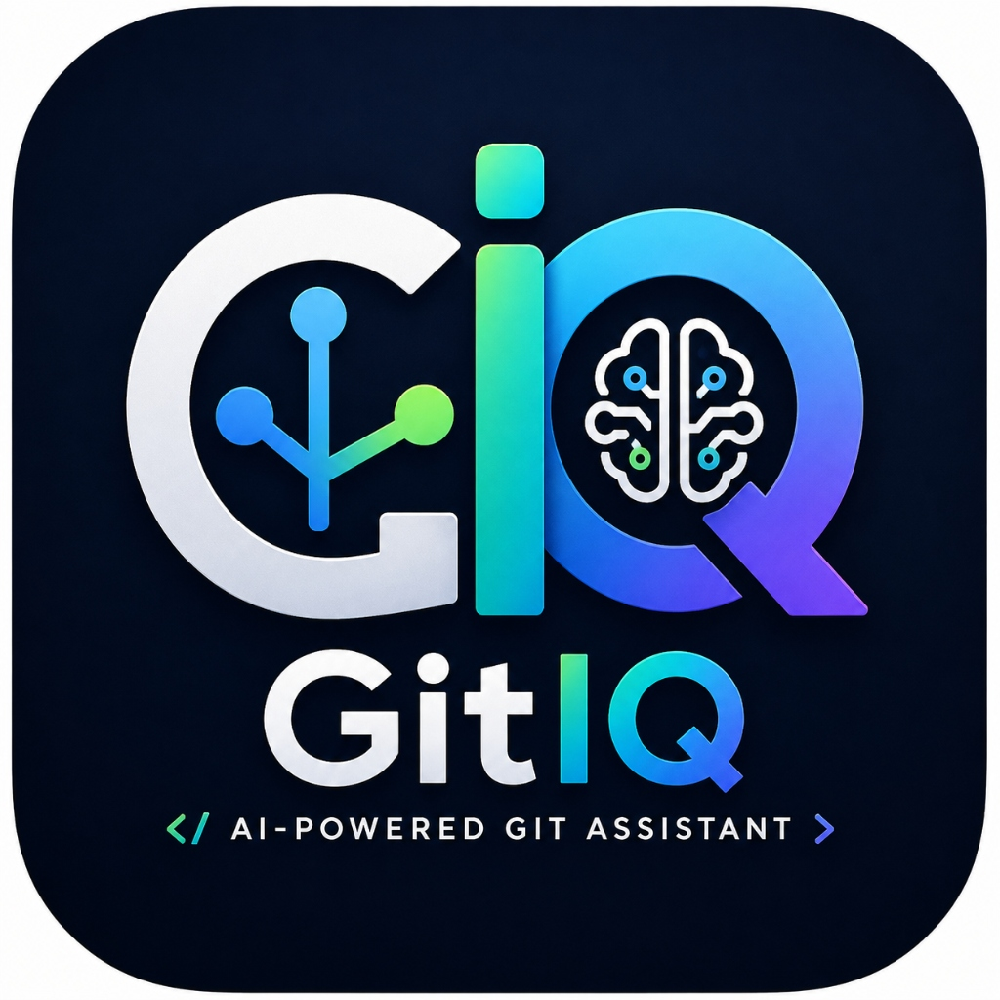

# GitIQ Extension - Detailed Documentation

<div align="center">



### AI-Powered Git Assistant for Visual Studio Code

</div>

---

## 📌 Extension Details

* **Extension Name**: GitIQ
* **Extension ID**: `gitiq.gitiq`
* **Publisher**: `gitiq`
* **Version**: `1.0.2`
* **VS Code Compatibility**: `^1.95.0`
* **Repository**: [CommitPilot-AI](https://github.com/ThakurDivyanshsingh-77/CommitPilot-AI)
* **License**: MIT License

---

## 📥 Installation Guide

### Marketplace / Open VSX / VSIX Package
1. **VS Code Marketplace**: Search `GitIQ` in the VS Code Extensions View (`Ctrl+Shift+X` / `Cmd+Shift+X`) and click **Install**.
2. **Open VSX Registry**: Download or install directly via Open VSX Registry.
3. **VSIX Package Installation**: Download `gitiq-1.0.2.vsix` and run in VS Code Command Palette:
   ```bash
   Extensions: Install from VSIX...
   ```

### Install Ke Baad Setup (Post-Installation)
1. VS Code window reload karein agar prompted ho.
2. Command Palette open karein: `Ctrl+Shift+P` (macOS: `Cmd+Shift+P`).
3. Command execute karein: **`GitIQ: Set Groq API Key`**.
4. Apna free Groq API Key (`gsk_...`) enter karein.

---

## 🔑 API Configuration & Security

* **API Provider**: Groq API (`groq-sdk` v1.5.0)
* **Supported Models**:
  - `llama-3.3-70b-versatile` (Default High Performance Model)
  - `llama-3.1-8b-instant` (Ultra Fast Lightweight Model)
  - `openai/gpt-oss-120b`
  - `deepseek-r1-distill-llama-70b`
* **API Key Add Karne Ka Method**:
  - Open Command Palette (`Ctrl+Shift+P`) ➔ Run `GitIQ: Set Groq API Key`.
  - Stored securely in OS native credential store (Windows Credential Manager / macOS Keychain / Linux Secret Service) using VS Code `SecretStorage` API (`vscode.SecretStorage`).
* **Settings & Commands**:
  - **Commands**:
    - `gitIQ.setApiKey` (`GitIQ: Set Groq API Key`)
    - `gitIQ.updateApiKey` (`GitIQ: Update Groq API Key`)
    - `gitIQ.removeApiKey` (`GitIQ: Remove Groq API Key`)
    - `gitIQ.selectModel` (`GitIQ: Select Groq Model`)
  - **Configuration Settings (`settings.json`)**:
    - `gitIQ.provider`: Active AI provider (`"groq"`)
    - `gitIQ.model`: Model identifier (`"llama-3.3-70b-versatile"`)
    - `gitIQ.temperature`: AI creativity parameter (`0.2`)
    - `gitIQ.timeout`: Request timeout in ms (`30000`)

---

## ✨ Features Breakdown

1. **AI Conventional Commit Generator**:
   - Inspects staged Git diff (`git diff --cached`).
   - Automatically drafts standardized Conventional Commit messages (`feat:`, `fix:`, `refactor:`, `docs:`, `perf:`, `test:`, `chore:`).
   - Shows editable QuickInput prompt for developer verification before committing.

2. **AI Commit Explanation**:
   - Select any commit from history log.
   - Generates plain English breakdown: purpose of changes, list of modified files, and high-level architectural impact.

3. **AI Pull Request Generator**:
   - Computes diff and commit history between target branch (e.g. `main`) and feature branch.
   - Generates full Markdown PR description including Title, Summary, Files Changed, Testing Steps, Breaking Changes, and Task Checklist.

4. **Offline Commit History Analytics**:
   - **Search History**: Keyword search across all commits using `git log --grep`.
   - **Top Contributors**: Ranked contributor commit count using `git shortlog -sn`.
   - **Commit Activity**: 7-day commit distribution summary table.
   - **Export Report**: Saves report to `commit-history-report.md`.

5. **GitHub Integration & Remote Sync**:
   - Push (`gitIQ.push`), Pull (`gitIQ.pull`), Fetch (`gitIQ.fetch`).
   - Open active repository or active branch directly on GitHub in browser.
   - Open GitHub compare URL for single-click PR creation.

---

## 🔄 Main Workflow

1. **Stage Code Changes**:
   ```bash
   git add .
   ```
2. **Configure API Key** (First Time):
   `Ctrl+Shift+P` ➔ `GitIQ: Set Groq API Key` ➔ Enter `gsk_...`
3. **Generate Commit Message**:
   `Ctrl+Shift+P` ➔ `GitIQ: Generate Commit Message`
4. **Review & Confirm**:
   Review or edit the AI-generated commit message in the QuickInput box and hit `Enter` to finalize git commit.
5. **Generate PR Document**:
   `Ctrl+Shift+P` ➔ `GitIQ: Generate Pull Request`
6. **Push & Open GitHub PR Page**:
   `Ctrl+Shift+P` ➔ `GitIQ: Push Branch` ➔ `GitIQ: Open Pull Request Page`

---

## 🛠️ Complete Commands & Buttons Reference

| # | Command Name | Command ID | Purpose |
| :--- | :--- | :--- | :--- |
| **1** | `GitIQ: Generate Commit Message` | `gitIQ.generateCommitMessage` | Analyzes staged diff and generates AI Conventional Commit. |
| **2** | `GitIQ: Generate Pull Request` | `gitIQ.generatePullRequest` | Generates full PR document from branch diff and history. |
| **3** | `GitIQ: View Commit History` | `gitIQ.viewCommitHistory` | Interactive QuickPick commit history explorer. |
| **4** | `GitIQ: Explain Commit` | `gitIQ.explainCommit` | AI plain-English commit explanation. |
| **5** | `GitIQ: Set Groq API Key` | `gitIQ.setApiKey` | Prompts and saves Groq API key securely in SecretStorage. |
| **6** | `GitIQ: Export History Report` | `gitIQ.exportHistoryReport` | Exports commit history analytics to `commit-history-report.md`. |
| **7** | `GitIQ: Open Pull Request Page` | `gitIQ.openPullRequestPage` | Launches GitHub compare page in default browser. |

---

## 🤖 AI Output Examples

### Commit Message Output Example:
```text
feat(auth): add Groq API key secure storage using VS Code SecretStorage

- Store API keys in OS native keychain via SecretStorage
- Implement select model QuickPick menu for Groq models
- Add input validation and error handling for API completion
```

### Pull Request Output Example:
```markdown
# Pull Request: Add AI Commit & PR Generation via Groq API

## 📝 Summary
This PR introduces full AI-powered Conventional Commit generation and automated Pull Request creation for VS Code using the Groq API SDK.

## 🔄 Changes Included
- Implemented `GroqProvider` and `AIProviderFactory`
- Added command handlers for commit generation, PR creation, and analytics
- Integrated `SecretStorage` for secure API key management

## 🧪 Testing & Verification
- Tested commit generation on staged diffs
- Verified offline analytics export (`commit-history-report.md`)

## ✅ Checklist
- [x] Code passes ESLint without warnings
- [x] Commands tested in VS Code Extension Host
- [x] Documentation updated in README.md and PROJECT_CONTEXT.md
```
